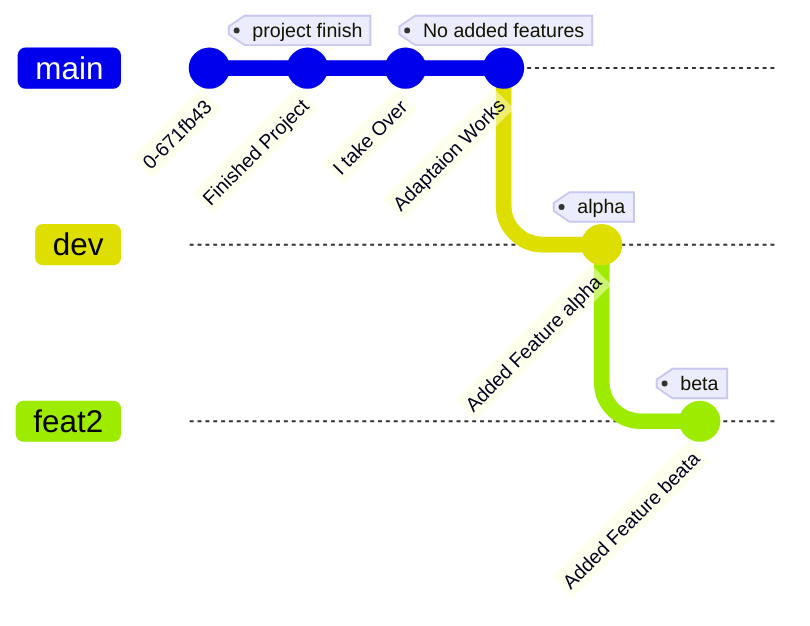
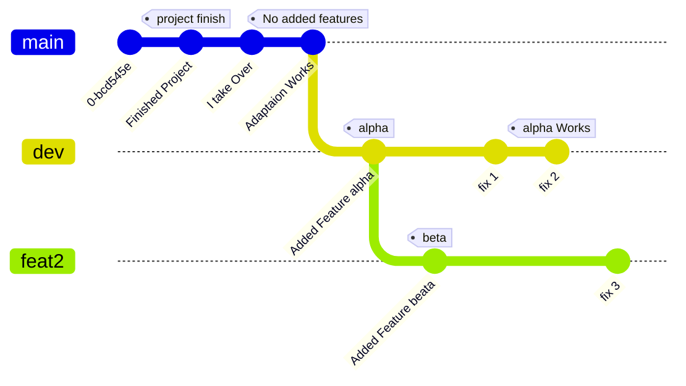
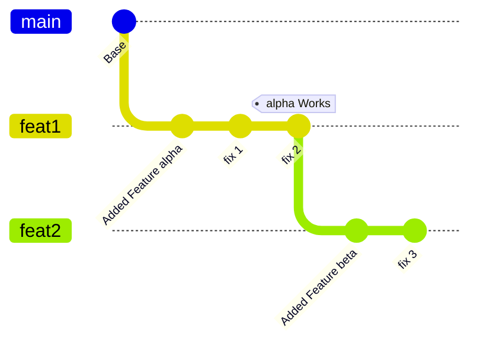
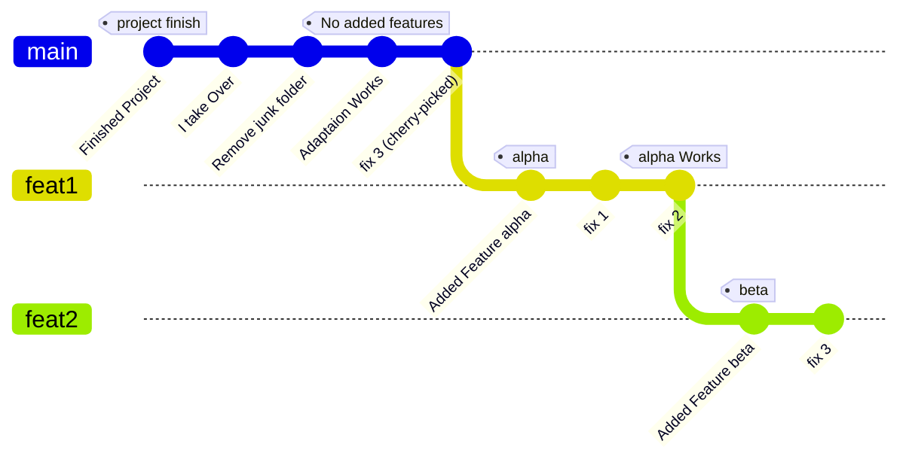
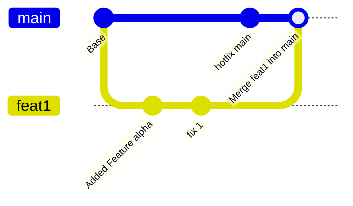

	# Guide Pratique Git : Gestion de Branches, Rebase, Clean Up et Restructuration

Ce document récapitule l'ensemble des procédures Git abordées pour structurer efficacement un projet, réorganiser des branches de fonctionnalités, déplacer ou fusionner des commits, et maintenir un historique propre.

---

Only featured added, not tested



Starting test :


## 1. Rebaser une Branche de Fonctionnalité

Lorsqu'une branche de développement (`feat1`) a été validée et corrigée, vous souhaitez aligner la branche suivante (`feat2`) sur la version fonctionnelle la plus récente.

### Procédure
```bash
git checkout feat2
git rebase feat1
# Then you have a detached head that you need to re atach 

# the -B foce the branche on your detached head 
# then git pull (will need to merge) then push
```

### Explication visuelle


---

## 2. Déplacer un Commit Spécifique (`cherry-pick`)

Pour appliquer un correctif ou une modification ciblée (ex: `fix 3`) d'une branche secondaire sur `main` sans fusionner l'ensemble des branches :

### Procédure
```bash
git checkout main
git cherry-pick <hash-fix3>
```

### Effet
Un nouveau commit contenant exactement les mêmes modifications que `fix 3` est créé sur `main`. La branche d'origine reste inchangée.

---

## 3. Fusionner plusieurs Commits Consécutifs (`squash`)

Pour nettoyer l'historique local avant un partage ou un push, vous pouvez combiner plusieurs petits commits consécutifs en un seul commit synthétique.

### Procédure
```bash
# Lancer le rebase interactif sur les N derniers commits (ex: 3)
git rebase -i HEAD~3
```

### Modification dans l'éditeur
```text
pick a1b2c3d Message du premier commit (plus ancien)
squash e4f5g6h Message du deuxième commit
squash i7j8k9l Message du troisième commit
```
1. Conserver `pick` sur le commit le plus ancien.
2. Remplacer `pick` par `squash` (ou `s`) sur les commits suivants à fusionner.
3. Enregistrer et fermer, puis valider le message de commit final.

> **Note :** Si la branche a déjà été poussée sur le dépôt distant, le push devra être forcé : `git push origin <branche> --force-with-lease`.

---

## 4. Supprimer un Commit

### Cas 1 : Commit non pushé

* **Conserver les modifications dans le dossier de travail :**
  ```bash
  git reset --soft HEAD~1
  ```
* **Effacer définitivement le commit et les modifications :**
  ```bash
  git reset --hard HEAD~1
  ```
* **Supprimer un commit intermédiaire spécifique :**
  ```bash
  git rebase -i HEAD~N
  # Remplacer 'pick' par 'drop' en face du commit concerné
  ```

### Cas 2 : Commit déjà pushé

* **Méthode propre (Revert - Recommandée en équipe) :**
  ```bash
  git revert <hash-commit>
  git push origin <branche>
  ```
  *(Crée un nouveau commit qui annule les modifications du commit visé sans altérer l'historique passé).*

* **Méthode de suppression définitive (Rewrite - Pour branche personnelle) :**
  ```bash
  git reset --hard HEAD~1
  git push origin <branche> --force-with-lease
  ```

Sur les machines distantes qui sont en avance :
```bash
git rebase --abort
git reset --hard origin/coremark
```

---

## 5. Renommer une Branche

### Procédure
```bash
# Renommage local
git branch -m ancienne-branche nouvelle-branche

# Mise à jour sur le dépôt distant (si nécessaire)
git push origin --delete ancienne-branche
git push origin -u nouvelle-branche
```

### Delete un branche

```bash 
# enlever une branche loclale bien merge : 
git branch -d <branch_name>
# une avec des commit jamais merge (so discar work on this branch)
git branch -D <branch_name>

#pour pouser les modif :
git push origin --delete <branch_name> 
# premiere etape pa necsessaire si la branche est uniquement origin/branch-to-delete
```
## publier une branche
Si on a une branche local et qu'on veut la publier en origin/ma-branche
```bash 
git push -u origin <branch_name>
```


---

## 6. Renommer un Fichier et Propager via Rebase

### Procédure sur `main`
```bash
git checkout main
git mv ancien_nom.v nouveau_nom.v
git commit -m "Rename file"
```

### Propagation sur les branches secondaires
```bash
git checkout feat1
git rebase main
```
Git gère automatiquement le suivi du fichier et applique vos modifications internes au nouveau nom de fichier.

---

## 7. Supprimer un Dossier Indésirable sans Altérer le Passé

Pour supprimer un dossier lourd ou obsolète (ex: dossier "junk") à partir de votre prise en main du projet, sans réécrire les commits des prédécesseurs :

### Procédure
```bash
git checkout main
git rm -r dossier_junk/
git commit -m "Remove junk folder"
```

Le dossier est retiré pour tous les travaux futurs. Les commits antérieurs restent intacts.

---

## 8. Bilan de la Structure Globale du Projet

L'organisation finale du dépôt après restructuration et application des opérations :



---

### 9. Fusionner des Branches (`git merge`)

Contrairement au _rebase_ qui réécrit l'historique de manière linéaire, `git merge` combine l'historique de deux branches en créant un **commit de fusion** (_merge commit_). C'est la méthode privilégiée pour intégrer définitivement une branche de fonctionnalité validée (ex: `feat1`) dans la branche principale (`dev` ou `main`) tout en conservant la traçabilité explicite des développements parallèles.

#### Procédure

Bash

```
# 1. Se placer sur la branche cible (ex: dev)
git checkout dev

# 2. Fusionner la branche de fonctionnalité (ex: feat1)
git merge feat1

# 3. Mettre à jour le dépôt distant
git push origin dev
```

#### Les deux types de fusions principaux

- **Fast-Forward (Avance rapide) :** Si la branche cible (`dev`) n'a pas évolué depuis le départ de `feat1`, Git déplace simplement le pointeur de `dev` jusqu'au dernier commit de `feat1` sans créer de commit de fusion.
    
- **3-Way Merge (Fusion à 3 voies) :** Si `dev` et `feat1` ont toutes deux évolué en parallèle, Git compare le commit parent commun et les deux derniers commits pour générer automatiquement un nouveau commit de fusion.
    

> **Astuce :** Pour forcer la création d'un commit de fusion même en situation d'avance rapide (afin de conserver la trace visuelle qu'une branche a existé), utilisez l'option `--no-ff` :
> 
> Bash
> 
> ```
> git merge --no-ff feat1
> ```

#### Explication visuelle (3-Way Merge)

Extrait de code



## Synthèse des Recommandations pour l'Analyse Matérielle (Area & Power)

* **Branches distinctes :** Conserver une branche dédiée par niveau de fonctionnalités (`feat1`, `feat2`) est optimal pour exécuter les outils de synthèse (Vivado, Design Compiler) sur des architectures matérielles distinctes.
* **Option `git worktree` :** Pour éviter de commuter continuellement de branche sur le même répertoire de travail lors des analyses comparative :
  ```bash
  git worktree add ../projet-feat1 feat1
  git worktree add ../projet-feat2 feat2
  ```


git worktree add ../feat/rv32e-16regs